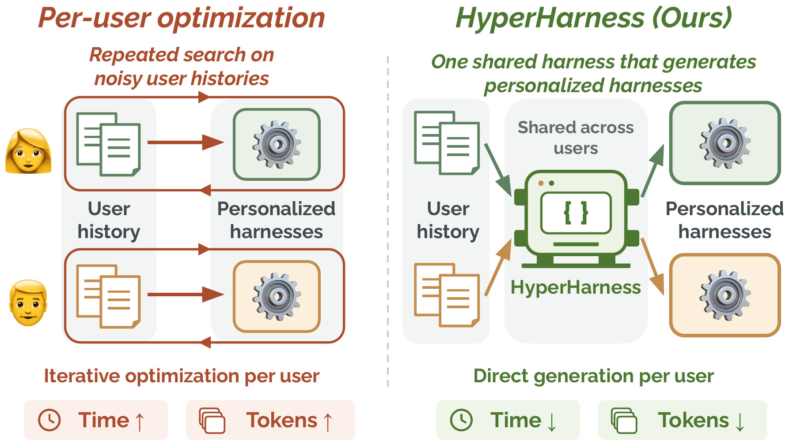
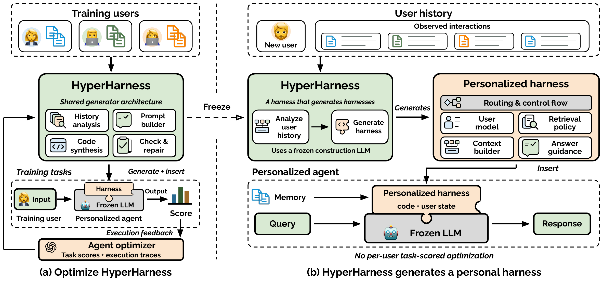

<h1 align="center">HyperHarness</h1>

<p align="center"><strong>Learning to Generate Personalized Agent Harnesses from User Histories</strong></p>

<p align="center">
  🌐 <a href="https://zhaoxuan.info/hyperharness/">Project page</a> &nbsp;·&nbsp;
  🧪 <a href="#main-experiments">Experiments</a> &nbsp;·&nbsp;
  🛠️ <a href="#setup">Setup</a> &nbsp;·&nbsp;
  📖 <a href="#citation">Citation</a>
</p>

<p align="center">
  
</p>

## How HyperHarness works

HyperHarness uses downstream task scores from training users to improve a
shared generator. At deployment, the frozen generator turns a new user’s
history into executable code that retrieves evidence and guides a frozen
answering model. Each user’s harness is built once and reused across queries.

<p align="center">
  
</p>

## Main experiments

**Starting from the public benchmark releases?** Follow the
[paper reproduction guide](docs/public_reproduction.md) to fetch pinned data,
verify the original user and query splits, and register a fresh TRAIN-to-TEST run.
The setup below also supports existing registered study inputs.

| Benchmark | CLI name | Task |
| :--- | :--- | :--- |
| **PersonaMemv3** | `pm3` | Personalized assistant responses and recommendations |
| **Mem-PAL** | `mempal` | English solution selection from interaction history |
| **MemoryCD** | `memorycd` | Cross-domain item ranking, rating prediction, review summarization, and review generation |

## Setup

### 1. Install the experiment runner

On Linux, install Git, Python 3.11 or newer, and the Codex CLI. With Node.js and
npm installed, you can install Codex with the first command below.

```bash
npm install -g @openai/codex@latest
codex --version

git clone https://github.com/TamSiuhin/hyperharness-code.git
cd hyperharness-code
python3 -m venv .venv
source .venv/bin/activate
python -m pip install -e '.[memorycd,eval,dev,luna]'
python scripts/run_hyperharness_reference.py --help
```

### 2. Locate your registered study inputs

Use a reference snapshot for each benchmark you want to run. Each snapshot
contains `train/` and `test/` directories with `plan.json`, `registration.json`,
and the runtime files listed in those registrations. Make the separately
provisioned dataset files available at the paths recorded in the plans. For
PersonaMemv3, use the pinned evaluator and native TEST input bundle from its
registration.

The examples run PersonaMemv3. Point `PM3_REFERENCE` to its snapshot directory.
If you need to fetch the evaluator, use the `evaluator_root` path recorded in
the plan as `PM3_EVALUATOR_DIR`.

```bash
export PM3_REFERENCE="/path/to/personamemv3-reference"
PM3_EVALUATOR_DIR="/path/from/plan/evaluator_root" bash scripts/fetch_pm3_evaluator.sh
```

### 3. Choose an API provider

Choose either configuration below. Replace the model IDs or deployment names
with values available to your account. The generator writes the per-user
harness, the optimizer refines the shared generator on TRAIN, the answering
model responds to queries, and the judge scores responses when the benchmark
requires it. For hosted answers, use a deployment that supports structured
outputs and `reasoning_effort=none`, such as GPT-5.6-Luna. Codex CLI uses the
Responses API for optimization. Construction, answering, and judging use Chat
Completions. Both clients use the credentials exported in your shell.
[Environment variable template](.env.example)

#### OpenAI API

```bash
read -rsp 'OpenAI API key: ' OPENAI_API_KEY
export OPENAI_API_KEY
printf '\n'
study="$PWD/runs/pm3-openai"

python scripts/run_hyperharness_reference.py prepare \
  --root "$study" --datasets pm3 --pm3-reference "$PM3_REFERENCE" \
  --provider openai \
  --generator-model gpt-6-sol --optimizer-model gpt-6-sol \
  --answer-model gpt-5.6-luna --judge-model gpt-5.5

python "$study/code/scripts/run_hyperharness_reference.py" run --root "$study"
```

#### Azure OpenAI API

Set the resource endpoint and API version, then use the Azure deployment names
of your reasoning-capable GPT models. Codex uses Responses API version
`2025-04-01-preview` by default. You can override it with
`AZURE_OPENAI_RESPONSES_API_VERSION`.

```bash
export AZURE_OPENAI_ENDPOINT="https://your-resource.openai.azure.com/"
export AZURE_OPENAI_API_VERSION="2025-04-01-preview"
read -rsp 'Azure OpenAI API key: ' AZURE_OPENAI_API_KEY
export AZURE_OPENAI_API_KEY
printf '\n'
study="$PWD/runs/pm3-azure"

python scripts/run_hyperharness_reference.py prepare \
  --root "$study" --datasets pm3 --pm3-reference "$PM3_REFERENCE" \
  --provider azure \
  --generator-model your-generator-deployment \
  --optimizer-model your-optimizer-deployment \
  --answer-model your-answer-deployment --judge-model your-judge-deployment

python "$study/code/scripts/run_hyperharness_reference.py" run --root "$study"
```

### 4. Read the results

Use a fresh `--root` for each `prepare`. This step validates and freezes the
study settings before any model calls. The `run` command evaluates the initial
generator, optimizes it on TRAIN, then evaluates the initial and selected
generators on held-out TEST users.

| Output under `--root` | Contents |
| :--- | :--- |
| `summary.json` | Aggregate metrics by benchmark |
| `<dataset>/train/selection.json` | Selected generator checkpoint |
| `<dataset>/pipeline.log` | Per-benchmark run log |

To include other benchmarks, add their CLI names to `--datasets` and supply
`--mempal-reference` or `--memorycd-reference`. To keep the snapshot’s local
answering model, omit `--answer-model` and start its OpenAI-compatible
server. For PersonaMemv3, export the server’s own `OHPU_EXECUTOR_API_KEY`.
Pass `--executor-profile qwen38-27b` at preparation to use Qwen3.8-27B
served at `http://127.0.0.1:8002/v1`.

<details>
<summary>Prepare a new benchmark dataset</summary>

Prepare new Mem-PAL or MemoryCD inputs on local storage with Linux `findmnt`.
Use a fresh output directory in each case.

- **Mem-PAL.** Check out the upstream dataset at the revision recorded in the
  loader and call `ohpu.benchmarks.mempal.prepare_dataset(source, output)`.
  [Mem-PAL loader](src/ohpu/benchmarks/mempal.py)
- **MemoryCD.** Use the source revision and checksums recorded in the loader,
  then run `python -m ohpu.benchmarks.memorycd --source /path/to/source --out /path/to/output`.
  [MemoryCD loader](src/ohpu/benchmarks/memorycd.py)

Use `register` and `study` on the corresponding driver. Pass `--host-source`
a frozen host directory containing `pm3_native_skillopt.py`, `pm3_skillopt.py`,
`pm3_harness.py`, `pm3_official_driver.py`, `runner.py`, and `base_runner.py`.
[Mem-PAL driver](analysis/skill_optimization_diagnosis/mempal_phg.py) ·
[MemoryCD driver](analysis/skill_optimization_diagnosis/memorycd_phg.py)

</details>

## Learned generators

`learned/<dataset>/<executor>/generator/` contains the shared generator that
TRAIN selected in each of the nine paper runs. These are the generators that
were evaluated on TEST. Each `manifest.json` gives the selected round and the
hashes of the selected and initial generators.

| Benchmark | Qwen3.5-9B | Qwen3.8-27B | GPT-5.6-Luna |
| :--- | :---: | :---: | :---: |
| **PersonaMemv3** | r9 | r9 | r5 |
| **Mem-PAL** | r1 | r2 | r10 |
| **MemoryCD** | r6 | r10 | r5 |

```bash
python scripts/learned_generator.py verify
python scripts/learned_generator.py show pm3 qwen35-9b
```

Each run starts from the initial generator that `scripts/paper_study.py`
registers for the same benchmark and executor. To see what optimization
changed, compare `generator/` with `train/generator/v0/` from a fresh
registration.

## Tests

The test suite uses local fixtures and mocked model calls.

```bash
bash scripts/fetch_pm3_evaluator.sh
python -m pytest -q
```

## Citation

```bibtex
@misc{tan2026hyperharness,
  title = {{HyperHarness}: Learning to Generate Personalized Agent Harnesses from User Histories},
  author = {Tan, Zhaoxuan and Zhao, Jiachen and Yang, Jingbo and Liu, Zheyuan and
            Wang, Chuhan and Zhou, Pei and Wan, Mengting and Jiang, Meng},
  year = {2026}
}
```
